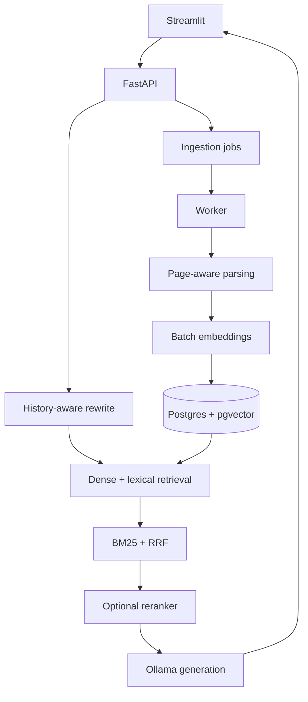

# Intelligent Document Assistant (Advanced Hybrid RAG)

A local-inference document Q&A application using FastAPI, PostgreSQL/pgvector, Sentence Transformers, Ollama and Streamlit. Upgraded from the original PDF assistant without requiring a paid LLM API.

## Features

- Admin-managed shared knowledge base; ordinary users have private chat histories.
- Argon2 password hashing, server-controlled roles, environment-supplied JWT secret and ownership checks.
- Page-aware PDF extraction, TXT/Markdown/CSV support, configurable token-aware chunking, batched normalized embeddings, duplicate document detection.
- Cosine vector retrieval + full-text candidate search, candidate-local BM25, reciprocal rank fusion, optional cross-encoder reranking and optional history-aware query rewriting.
- Document filtering, insufficient-evidence responses, persisted source excerpts and page references, retrieval and generation latency.
- Durable Postgres ingestion jobs with lease recovery and retries, optional Redis query embedding caching, Docker Compose and test suite.

## Architecture



## Local setup

Use Python 3.11+ and a new PostgreSQL database with pgvector installed. Install Ollama separately and download Mistral.

```bash
python -m venv .venv
source .venv/bin/activate
pip install -e .
cp .env.example .env
```

Edit `.env` to set your actual database URL and a **new random JWT secret**. Do not reuse credentials from the original repository. For example, generate a random secret locally with `python -c "import secrets; print(secrets.token_urlsafe(48))"`.

```bash
ollama pull mistral
python -m backend.init_db
python -m backend.create_admin
uvicorn backend.main:app --reload
```

In two more terminals (same virtual environment):

```bash
python -m backend.worker
streamlit run streamlit_app.py
```

Open http://localhost:8501, log in as the provisioned admin, and navigate to Documents to upload sample files from `uploads/`. Refresh ingestion jobs until they complete, then use Chat to ask questions. Register normal users separately.

The workspace includes searchable conversation history, document filters, individual message citations, response timing, ingestion status, document management and a System health view. Real-time token streaming and original PDF preview are not implemented by the current backend.

API documentation: http://localhost:8000/docs.

## Docker Compose

Copy `.env.example` to `.env`, set a URL-safe PostgreSQL password and a new JWT secret, then:

```bash
docker compose up -d --build
docker compose exec ollama ollama pull mistral
docker compose exec api python -m backend.create_admin
```

The UI and API bind to loopback by default. The worker retrieves queued files from Postgres, deletes payloads after completion or terminal failure and can recover expired leases. Redis is enabled in the Compose setup. First-time model downloads can take time. CPU inference is supported but may be slow.

## Configuration

| Key | Default |
|---|---|
| EMBEDDING_MODEL | sentence-transformers/all-MiniLM-L6-v2 |
| EMBEDDING_DIMENSION | 384 (fixed schema; changes require migration/reindex) |
| CHUNK_TOKENS | 220 |
| OVERLAP_TOKENS | 32 |
| CANDIDATE_COUNT | 24 per retriever |
| TOP_K | 5 |
| MIN_COSINE_SIMILARITY | 0.35 (calibrate on a labeled dataset) |
| ENABLE_HYBRID | true |
| ENABLE_RERANKING | false |
| ENABLE_QUERY_REWRITING | true |
| OLLAMA_MODEL | mistral |
| REDIS_URL | optional |

BM25 statistics are computed within lexical candidates, not across the entire corpus. PostgreSQL full-text search supplies independent lexical candidates. Fusion scores are ranking signals, not calibrated probabilities. Page references are retrieved evidence; the model may still make unsupported claims.

## API

| Method | Endpoint | Purpose |
|---|---|---|
| POST | /register | Create normal user |
| POST | /login | Obtain JWT |
| POST | /upload | Queue document ingestion (admin) |
| GET | /ingest/jobs | View recent ingestion jobs (admin) |
| GET | /documents | List shared indexed documents |
| DELETE | /documents/{id} | Remove document (admin) |
| POST | /conversations/start | Create chat |
| GET | /conversations/list | List owned chats |
| GET | /conversations/messages/{id} | Read owned chat messages |
| POST | /conversations/chat | Ask question with optional document IDs |
| DELETE | /conversations/delete/{id} | Delete owned chat |
| GET | /health | Database connectivity |

## Tests and evaluation

```bash
python -m unittest discover -s tests -v
python -m evaluation.run
```

The evaluation runner requires the sample PDFs to be indexed in the configured PostgreSQL database. Ten verified document-level starter queries are provided. All five original sample PDFs are single-page roadmaps, so this evaluation cannot measure passage-level or page-level retrieval precision; add a larger corpus and human-labeled passage references for a credible benchmark.

Run dense retrieval (`ENABLE_HYBRID=false`), hybrid retrieval and hybrid + reranker (`ENABLE_RERANKING=true`) on the same indexed corpus. Compare document recall, reciprocal rank and latency; then expand with human-reviewed correctness, faithfulness, citation accuracy, abstention and P95 latency. No benchmark results are claimed here.

## Upgrade from v1

**Use a new database for this version.** The original schema has no page metadata, chunk index or job table and stores passwords in plaintext. The bootstrap deliberately rejects the old chunk schema. Back up existing data, rotate the original credentials, provision new accounts with hashed passwords, and re-upload your original documents to regenerate page-aware normalized vectors. Existing chat data is not automatically migrated. Do not delete the original database.

## Before public deployment

This is a production-oriented foundation, not a production certification. Validate PostgreSQL/pgvector queries, workers and Ollama against a real deployment; run representative load and RAG evaluation tests. Add TLS, reverse-proxy request limits/rate limiting, backups and monitoring, explicit versioned migrations, private document collections if required, OCR, response streaming, hierarchical summaries, stronger citation verification, and operational alerts. The administrator-uploaded corpus is intentionally shared with all authenticated users; upload only material intended for that audience.

## License

Original repository did not specify a license. Obtain the author's approval before redistributing or publishing modified source.
